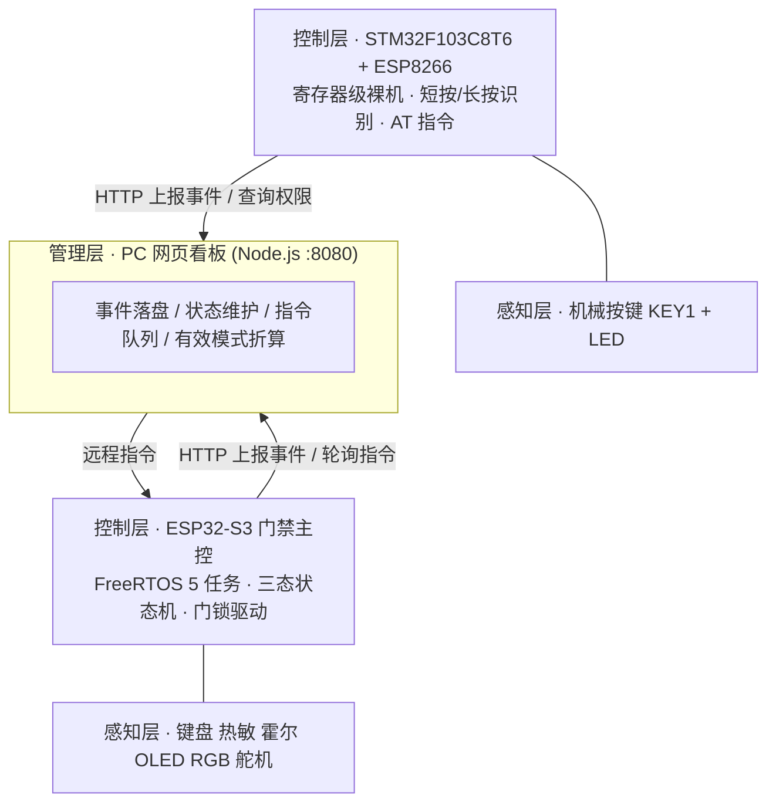

# SmartGuard · 智能安防门禁系统

> 传感器原理及应用课程设计（第 15 组）
> **双控制器架构**：ESP32-S3 门禁主控 + STM32F103 物理按键控制器，通过 Node.js 网页看板互联。

一套可实际运行的智能门禁样机：键盘密码开门、按键快捷开关门、长按一键报警，配合温度/门磁感知实现布防入侵与高温强制开门告警，所有状态实时同步到网页看板，并支持远程下发指令。

---

## 系统架构



**三种安防状态**：`disarmed`（撤防）→ `armed`（布防）→ `emergency`（紧急）。
紧急态有四条统一入口（入侵、高温、长按、网页/按键指令），只有"ESP32 输密码"或"网页解除"能退出。

---

## 目录结构

```
.
├── firmware/
│   ├── esp32/            # ESP32-S3 门禁主控（PlatformIO + Arduino 框架）
│   │   ├── include/      #   config.h 引脚与阈值、wifi_config.h 联网参数
│   │   ├── src/hardware/ #   键盘/热敏/霍尔/OLED/舵机/RGB/WiFi 驱动
│   │   └── src/software/ #   FreeRTOS 任务、三态状态机、密码逻辑
│   └── stm32/            # STM32F103C8T6 按键控制器（CMake + arm-none-eabi-gcc）
│       ├── App/          #   main.c、按键状态机、ESP8266 AT/HTTP 客户端
│       ├── Core/         #   寄存器定义、时钟、串口（不依赖 HAL/SPL）
│       └── tools/        #   WCH-Link 烧录脚本与 OpenOCD 配置
├── dashboard/            # 网页看板（Node.js 零依赖 HTTP 服务 + 单页前端）
├── docs/                 # 设计报告（md / docx）与 PPT 制作指南
└── tools/                # 一键启动看板脚本（Windows）
```

---

## 快速开始

### 1. 网页看板（先起这个）

```bash
cd dashboard
node server.js            # → http://localhost:8080
```

Windows 直接双击 `tools/一键启动SmartGuard看板.bat`（会杀掉占用 8080 的旧进程再启动，并自检 `/api/mode` 接口）。

### 2. ESP32-S3 门禁主控

```bash
# VSCode + PlatformIO 打开 firmware/esp32，或用 CLI：
cd firmware/esp32
pio run -t upload && pio device monitor
```

烧录前改 `include/wifi_config.h`：`WIFI_SSID` / `WIFI_PASS` / `WEB_HOST`（看板所在电脑的局域网 IP）。

### 3. STM32 按键控制器

```bash
# CLion 打开 firmware/stm32（已带 CMakePresets），或命令行：
cmake --preset Release && cmake --build --preset Release
```

烧录前改 `App/Inc/wifi_config.h`（同一组 WiFi 参数）。烧录方式见 `firmware/stm32/tools/flash.md`。

> ⚠️ **ESP8266 必须独立供电**：模块射频发射瞬间峰值电流可达 300 mA，而 STM32 最小系统板的板载 AMS1117
> 只有约 100 mA。直接取电会出现"AT 时通时不通、能连网但随即断开"等难查故障。本项目通过自制 ESP 底座
> 为模块独立供电，并就近并联 100 μF（低频波动）+ 0.1 μF（高频噪声）电容。

---

## 硬件清单

| 器件 | 型号/规格 | 用途 |
| --- | --- | --- |
| 门禁主控 | ESP32-S3 核心板 | 核心控制 + 板载 WiFi |
| 按键控制器 | STM32F103C8T6 最小系统板 | 按键 / 权限查询 |
| WiFi 模块 | ESP8266-01S | 为 STM32 提供联网 |
| 温度传感器 | NTC 10K (B=3950) | 上拉分压接 ADC |
| 门磁 | 霍尔开关模块（数字输出） | 门体开合检测 |
| 输入 | 4×4 矩阵键盘 | 密码与功能键 |
| 显示 | SSD1306 OLED 0.96" (I2C) | 状态显示 |
| 执行器 | SG90 舵机 | 电子锁（0° 闭锁 / 90° 开锁） |
| 调试 | WCH-Link (CMSIS-DAP) | STM32 下载调试 |
| 搭建材料 | 面包板 + 自制 ESP 部分底座 | 模块转接与布线 |

---

## 通信协议速览

| 方法 | 路径 | 用途 | 调用方 |
| --- | --- | --- | --- |
| POST | `/api/event` | 上报事件（JSON） | ESP32、STM32 |
| GET | `/api/status` | 完整状态 + 最近 100 条事件 | 网页前端 |
| GET | `/api/mode?device=stm32` | 查询**有效模式**（一行短 JSON） | STM32 |
| POST | `/api/cmd` | 网页下发指令 | 网页前端 |
| GET | `/api/cmd` | 设备取走待执行指令（单槽位 + TTL） | ESP32 |

### 两个核心设计

**① 单一真相源 + 有效模式折算。**
安防模式只允许 ESP32 上报的事件改写；STM32 上报的 `cmd` 事件带 `mode` 字段表达的是"我请求变成什么"，不能覆盖全局状态。
不同设备需要的"模式"含义不同，由看板按请求方身份实时折算：

| 条件 | 返回 ESP32 | 返回 STM32 | 含义 |
| --- | --- | --- | --- |
| 主控紧急态 | emergency | emergency | 谁都别动门锁 |
| 主控布防 | armed | armed | STM32 按键开门被拒 |
| 主控撤防 | disarmed | disarmed | 自由 |
| 主控离线、STM32 在线 | — | stm32 | 控制权降级移交 |

**② 门禁主控不做本地状态推断。**
STM32 每次短按都实时查询一次权限，查询失败即保守拒绝。这样设备端不存在"可能卡死的本地锁"，
紧急状态何时解除完全由唯一权威（ESP32 / 看板）决定。

---

## 联调踩过的坑（节选）

| 现象 | 根因 | 解决 |
| --- | --- | --- |
| AT 指令无响应 | 模块上电自动重连热点，AT 通道被占 | 握手改"耐心版"，识别 `busy` 后延时重试 |
| 扫不到任何热点 | 模块射频/天线损坏 | 更换模块（AT 能通 ≠ 功能完好） |
| 连错同名热点 | Windows 软 AP 的 BSSID 是派生地址 | 用 `AT+CWJAP` 第三参数锁定 BSSID |
| 按键时通时不通 | ESP8266 供电不足，射频瞬间跌落至 2.6 V | 独立稳压 + 大小电容并联 |
| 模式与设备状态不一致 | STM32 指令事件污染全局模式 | 单一真相源 + 有效模式折算 |
| 退出紧急后无法开关门 | 本地锁存标志清不掉 | 取消锁存，改每次实时查询权限 |
| 按键"没反应"（卡 5 秒） | `AT+CIPSTART` 失败时硬等超时 | 单循环同时匹配 `CONNECT`/`ERROR`/`busy`，失败即退 |
| 查询模式永远失败 | 解析放到了 `tcp_close()` 之后，而 close 会清空接收缓冲 | 先解析、后关连接 |

---

## 文档

- `docs/设计报告.docx` — 完整设计报告（需求、硬件、软件、测试）
- `docs/设计报告.md` — 报告 Markdown 源
- `docs/PPT制作指南.md` — 答辩 PPT 逐页内容与话术建议

---

## License

MIT © 2026 张祯祥
